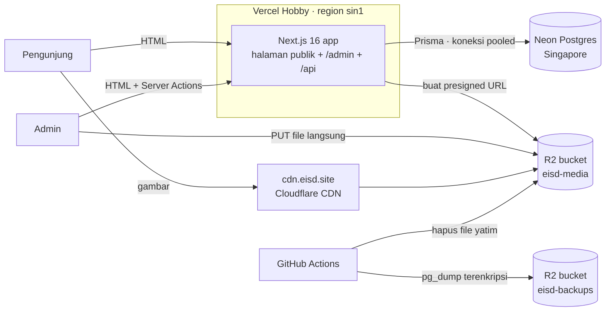
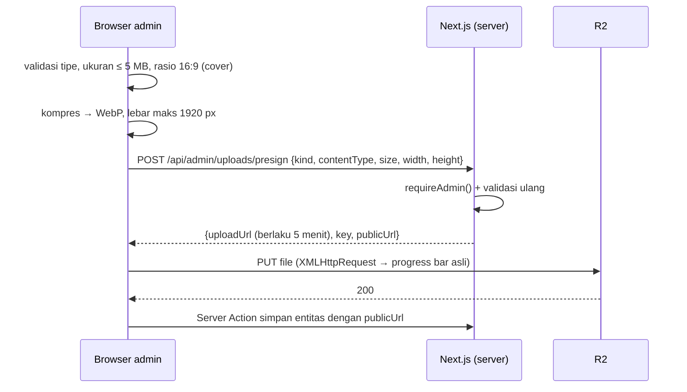

# Arsitektur WEB-EISD Fullstack (archi.md)

> **Status:** Draft untuk review tim · **Versi:** 0.1 · **Tanggal:** 24 November 2026
> **Penulis:** Faris · **Repo:** `EISD-Laboratory/WEB-EISD`
>
> Dokumen ini adalah acuan migrasi website EISD dari situs statis + CMS terpisah (`cms-eisd`) menjadi **satu aplikasi Next.js fullstack** dengan database **Neon Postgres** dan object storage + CDN **Cloudflare R2**. Dokumen ini juga menjadi spesifikasi untuk *challenge* rebuild backend yang dipindahkan dari `cms-eisd` ke repo ini.
>
> Bagian bertanda **⚠️ Keputusan terbuka** belum disepakati tim; isinya adalah rekomendasi penulis.

---

## Daftar isi

1. [Ringkasan](#1-ringkasan)
2. [Kondisi saat ini](#2-kondisi-saat-ini)
3. [Keputusan yang sudah dikunci](#3-keputusan-yang-sudah-dikunci)
4. [Gambaran arsitektur](#4-gambaran-arsitektur)
5. [Struktur folder](#5-struktur-folder)
6. [Model data](#6-model-data)
7. [Lapisan aplikasi](#7-lapisan-aplikasi)
8. [Rendering & caching](#8-rendering--caching)
9. [Autentikasi & otorisasi](#9-autentikasi--otorisasi)
10. [Upload & media (R2 + CDN)](#10-upload--media-r2--cdn)
11. [Artikel Medium](#11-artikel-medium)
12. [Keamanan](#12-keamanan)
13. [Lingkungan & konfigurasi](#13-lingkungan--konfigurasi)
14. [Operasional: backup, cleanup, CI](#14-operasional-backup-cleanup-ci)
15. [Batas free tier](#15-batas-free-tier)
16. [Rencana migrasi bertahap](#16-rencana-migrasi-bertahap)
17. [Challenge](#17-challenge)
18. [Keputusan terbuka & risiko](#18-keputusan-terbuka--risiko)
19. [Lampiran](#19-lampiran)

---

## 1. Ringkasan

| Aspek | Sebelum | Sesudah |
|---|---|---|
| Website publik | Next.js 16, `output: 'export'` (statis), konten hardcoded | Next.js 16 fullstack, konten dari database |
| CMS | Repo terpisah `cms-eisd` (Vite SPA), backend belum ada, login mock | Panel admin di `eisd.site/admin` dalam repo yang sama |
| Database | — | Neon Postgres + Prisma |
| Gambar | File di `public/images` | Cloudflare R2, disajikan lewat CDN `cdn.eisd.site` |
| Auth | Mock (`localStorage`) | Better Auth (library, data di Neon), tanpa signup publik |
| Update konten | Edit kode → commit → redeploy | Admin klik **Publish** → tampil dalam hitungan detik |
| Hosting | Vercel Hobby | Vercel Hobby (tetap) |
| Biaya | Rp0 | Rp0 (semua free tier) |

Tujuan utama: admin bisa mengelola **Events, Articles, Achievements** tanpa menyentuh kode, dengan keamanan dan ketersediaan yang layak untuk budget nol.

---

## 2. Kondisi saat ini

### 2.1 WEB-EISD (per `master` 4 Nov 2026)

- Next.js 16.3, **React 18.3**, **Tailwind 3.4**, TypeScript 5.9, npm.
- `next.config.js` memakai `output: 'export'` dan `images.unoptimized: true`.
- Halaman: `/`, `/about`, `/achievements`, `/articles`, `/contact`, `/events`, `/events/[id]`, `/structure`.
- Masalah konten:
  - Array `events` **ditulis dua kali** (`app/events/page.tsx` dan `app/events/[id]/page.tsx`), dengan `id` angka, `category`, `status` manual (`upcoming`/`completed`), `date` berupa teks bebas (`"April 2026"`), dan `gradient`.
  - `achievements` hardcoded (dengan field `image`).
  - Artikel diambil dari RSS Medium saat build (`lib/articles.ts`).
  - Data pengurus (~50 anggota) hardcoded di `structure/page.tsx` → **di luar scope V1**.
- `vercel.json` memasang CSP `default-src 'self'`, `img-src` hanya Medium, dan `Access-Control-Allow-Origin` global.

### 2.2 cms-eisd

- pnpm monorepo, `apps/frontend` (Vite + React 19 + Tailwind 4 + shadcn/ReUI), `packages/db` (skema Prisma).
- Backend sengaja dihapus untuk *challenge*; semua halaman memakai fixture. Login masih mock.
- Halaman admin yang sudah ada: `Login`, `Dashboard`, `Events` + `EventForm`, `Articles` + `ArticleForm`, `Achievements` + `AchievementForm`.
- Kontrak fitur ada di `docs/CHALLENGE.md` dan `openspec/specs/` → **diadopsi oleh dokumen ini** (lihat §7 dan §17).

---

## 3. Keputusan yang sudah dikunci

| # | Keputusan | Sumber |
|---|---|---|
| D1 | Repo akhir = **WEB-EISD**. UI admin di-port ke sini; `cms-eisd` diarsipkan setelah port selesai | Tim |
| D2 | **Satu aplikasi Next.js fullstack**; admin di `/admin` | Tim |
| D3 | *Challenge* tetap ada, dipindahkan ke repo ini | Tim |
| D4 | Scope V1: **Events, Articles, Achievements**. Pengurus/divisi = V2 | Tim |
| D5 | Kode anggota (`assistantCode`) **boleh tampil publik** | Tim |
| D6 | Database: **Neon Postgres** (free) | Tim |
| D7 | Object storage + CDN: **Cloudflare R2** | Tim |
| D8 | Admin = akses penuh (satu role) | Tim |
| D9 | Budget **nol** — semua layanan free tier | Tim |
| D10 | Dokumen arsitektur diajukan sebagai PR ke WEB-EISD | Tim |

---

## 4. Gambaran arsitektur



Prinsip:

1. **Satu sumber logika.** Semua aturan bisnis ada di `lib/server/services/*`. Halaman publik, Server Actions, dan Route Handlers memanggil service yang sama.
2. **Halaman publik membaca database langsung** dari Server Components (tanpa HTTP ke API sendiri), dengan cache berbasis tag.
3. **File tidak pernah lewat server.** Browser admin mengunggah langsung ke R2 dengan presigned URL; server hanya menandatangani dan mencatat.
4. **Admin terisolasi secara logika**: semua akses tulis wajib lolos pemeriksaan sesi di server, bukan hanya di `proxy.ts`.

---

## 5. Struktur folder

```text
WEB-EISD/
├─ app/
│  ├─ (public)/                 ← semua halaman publik (pindahan dari app/*)
│  │  ├─ layout.tsx             ← Navbar, Footer, AnnouncementBar, WelcomePopup
│  │  ├─ page.tsx
│  │  ├─ events/page.tsx
│  │  ├─ events/[slug]/page.tsx ← (redirect dari /events/<angka> lama, lihat §6.3)
│  │  ├─ articles/page.tsx
│  │  ├─ achievements/page.tsx
│  │  └─ about/ · contact/ · structure/
│  ├─ admin/
│  │  ├─ login/page.tsx
│  │  └─ (panel)/
│  │     ├─ layout.tsx          ← cek sesi (wajib), sidebar, tema admin
│  │     ├─ page.tsx            ← Dashboard
│  │     ├─ events/{page,new/page,[id]/page}.tsx + actions.ts
│  │     ├─ articles/{...}      + actions.ts
│  │     ├─ achievements/{...}  + actions.ts
│  │     └─ account/page.tsx    ← ganti password
│  ├─ api/
│  │  ├─ auth/[...all]/route.ts         ← handler Better Auth
│  │  ├─ admin/uploads/presign/route.ts ← presigned URL R2
│  │  └─ public/…                       ← (opsional) API read-only, lihat §7.3
│  ├─ layout.tsx                ← root: <html>, font, Speed Insights
│  ├─ robots.ts · sitemap.ts
├─ components/
│  ├─ public/                   ← komponen situs yang sudah ada
│  ├─ admin/                    ← port dari cms-eisd (ImageUpload, GalleryUpload, dll.)
│  └─ ui/                       ← shadcn/ReUI
├─ lib/
│  ├─ server/                   ← `import 'server-only'` di setiap file
│  │  ├─ db.ts                  ← Prisma client singleton
│  │  ├─ auth.ts                ← konfigurasi Better Auth
│  │  ├─ session.ts             ← requireAdmin()
│  │  ├─ r2.ts                  ← S3 client ke R2 + presign
│  │  ├─ medium.ts              ← fetch metadata Open Graph
│  │  └─ services/{events,articles,achievements,dashboard}.ts
│  ├─ validation/               ← skema Zod (dipakai form & server)
│  └─ shared/event-status.ts    ← hitung Incoming/On Going/Finished
├─ prisma/
│  ├─ schema.prisma
│  ├─ migrations/
│  └─ seed.ts                   ← impor data hardcoded saat ini
├─ scripts/
│  ├─ create-admin.ts
│  ├─ upload-legacy-images.ts   ← pindahkan public/images/events → R2
│  └─ cleanup-orphans.ts
├─ proxy.ts                     ← (Next 16 pengganti middleware.ts)
├─ .github/workflows/{ci,backup,cleanup}.yml
└─ docs/archi.md                ← dokumen ini
```

Catatan: `public/` tetap menyimpan aset brand (logo, OG image, favicon, ilustrasi statis). Foto event/achievement pindah ke R2.

---

## 6. Model data

### 6.1 Skema

Diambil dari `cms-eisd/packages/db/prisma/schema.prisma` (kontrak challenge), dengan **penambahan** yang dibutuhkan website publik dan auth. Penambahan ditandai `// +`.

```prisma
generator client { provider = "prisma-client-js" }

datasource db {
  provider = "postgresql"
  // URL pooled (runtime) & direct (migrasi) — lihat §13
}

model Event {
  id                 String    @id @default(uuid())
  slug               String    @unique
  legacyId           Int?      @unique            // + id angka lama untuk redirect /events/1
  title              String
  category           String                       // + Webinar, Seminar, Workshop, Public Lecture, Competition, Other
  previewDescription String
  content            String                       // rich text (HTML tersanitasi)
  coverImage         String                       // URL CDN, rasio 16:9
  headerImage        String
  galleryImages      String[]                     // maks 4
  location           String
  startDate          DateTime
  endDate            DateTime                     // ≥ startDate
  publishedAt        DateTime?                    // null = Draft
  createdAt          DateTime  @default(now())
  updatedAt          DateTime  @updatedAt

  @@index([startDate])
  @@index([publishedAt])
}

model MediumArticle {
  id            String    @id @default(uuid())
  url           String    @unique
  title         String
  description   String
  coverImage    String
  publishedDate DateTime
  publishedAt   DateTime?
  createdAt     DateTime  @default(now())
  updatedAt     DateTime  @updatedAt

  @@index([publishedAt])
}

model Achievement {
  id                   String              @id @default(uuid())
  category             String
  customCategory       String?
  level                String              // National | International
  result               String              // 1st Place | 2nd Place | 3rd Place | Finalist
  competitionName      String
  competitionYearMonth String              // YYYY-MM
  image                String?             // + foto, dipakai halaman publik
  createdAt            DateTime            @default(now())
  updatedAt            DateTime            @updatedAt
  members              AchievementMember[]

  @@index([level])
  @@index([competitionYearMonth])
}

model AchievementMember {
  id            String      @id @default(uuid())
  achievementId String
  achievement   Achievement @relation(fields: [achievementId], references: [id], onDelete: Cascade)
  name          String
  assistantCode String      @unique   // ⚠️ lihat §18 K3

  @@index([achievementId])
}

// + Tabel Better Auth (user, session, account, verification) dibuat oleh
//   CLI Better Auth (`npx @better-auth/cli generate`) lalu dimigrasikan Prisma.
```

`@@index([slug])` dan `@@index([url])` di skema lama dihapus karena kolom `@unique` sudah otomatis ber-index.

### 6.2 Aturan data (dari spesifikasi challenge)

- **Event**
  - Dibuat sebagai **Draft**; slug dibuat dari judul, diberi sufiks bila bentrok (`seminar-ai`, `seminar-ai-2`).
  - Publish/unpublish mengisi/mengosongkan `publishedAt` dengan **waktu server**.
  - Edit pada event yang sudah publish langsung tayang.
  - **Status tidak disimpan**, selalu dihitung: `hari ini < start` → *Incoming*; `start ≤ hari ini ≤ end` → *On Going*; `hari ini > end` → *Finished* (zona waktu `Asia/Jakarta`).
  - `coverImage` wajib 16:9, `galleryImages` maks 4.
- **MediumArticle**: dibuat dari URL saja, metadata (judul, deskripsi, cover, tanggal) di-*snapshot* sekali saat simpan. Draft → Publish seperti event.
- **Achievement**: tanpa Draft (langsung publik). Minimal 1 anggota; kode 4 huruf kapital; `Other` wajib `customCategory` 1–100 karakter; `competitionYearMonth` format `YYYY-MM`; urutan `competitionYearMonth desc, updatedAt desc`.

### 6.3 Pemetaan data lama → baru

| Data lama (WEB-EISD) | Data baru |
|---|---|
| `id: 1` | `legacyId: 1`, `slug` dari judul |
| `status: 'completed'` | dibuang (dihitung dari tanggal) |
| `date: 'April 2026'` | `startDate`/`endDate` — **diisi manual** saat seed karena teks bebas tidak bisa dikonversi otomatis |
| `gradient` | dibuang (gaya ditentukan di komponen berdasarkan `category`) |
| `image: '/images/events/...'` | diunggah ke R2 oleh `scripts/upload-legacy-images.ts`, URL CDN disimpan |
| `description` | `previewDescription`; `content` diisi dari detail event lama |
| Artikel RSS Medium | diimpor sekali ke `MediumArticle` (status Published) |

`/events/[slug]/page.tsx`: bila parameter berupa angka, cari `legacyId` lalu `permanentRedirect('/events/<slug>')`, sehingga tautan lama yang sudah tersebar di media sosial tetap berfungsi.

---

## 7. Lapisan aplikasi

```text
UI (Server/Client Components)
   │                 ▲
   ▼                 │
Server Actions  ·  Route Handlers  ·  Server Components (baca)
   │                                  │
   └──────────► lib/server/services/* ◄┘   ← validasi Zod + aturan bisnis
                          │
                 Prisma (lib/server/db.ts) · R2 (lib/server/r2.ts)
```

### 7.1 Service layer

Setiap service adalah fungsi biasa yang:

- menerima input yang sudah divalidasi Zod (atau memvalidasi sendiri),
- menjalankan aturan bisnis §6.2,
- tidak tahu apa-apa soal HTTP, cookie, atau cache.

Contoh antarmuka `services/events.ts`:

```ts
listPublishedEvents(): Promise<EventSummary[]>        // publik, di-cache
getPublishedEventBySlug(slug): Promise<EventDetail | null>
listEventsForAdmin(filter): Promise<EventAdminRow[]>  // termasuk draft, tidak di-cache
createEvent(input): Promise<Event>                    // selalu Draft
updateEvent(id, input): Promise<Event>
publishEvent(id) / unpublishEvent(id): Promise<Event>
deleteEvent(id): Promise<void>                        // + hapus gambar di R2
```

### 7.2 Mutasi: Server Actions

Form admin memanggil Server Actions di `app/admin/(panel)/**/actions.ts`. Pola wajib:

```ts
'use server'
import { updateTag } from 'next/cache'
import { requireAdmin } from '@/lib/server/session'
import * as events from '@/lib/server/services/events'

export async function publishEventAction(id: string) {
  await requireAdmin()                 // 1. selalu cek sesi di sini
  const ev = await events.publishEvent(id)
  updateTag('events')                  // 2. invalidasi cache publik
  updateTag(`event:${ev.slug}`)
  updateTag('dashboard')
  return { ok: true }
}
```

Alasan memilih Server Actions untuk mutasi: admin dan API berada di origin yang sama, jadi tidak perlu CORS, `withCredentials`, atau klien HTTP terpisah. Format respons error mengikuti kontrak challenge (field errors untuk 400, 409 untuk konflik kode anggota) dalam bentuk objek `{ ok: false, code, fieldErrors }`.

### 7.3 Route Handlers

Hanya untuk yang memang butuh endpoint HTTP:

| Route | Fungsi |
|---|---|
| `/api/auth/[...all]` | Login, logout, sesi (Better Auth) |
| `POST /api/admin/uploads/presign` | Membuat presigned PUT URL ke R2 (§10) |
| `/api/public/*` (opsional) | API read-only sesuai kontrak publik challenge, untuk konsumen di luar website |

### 7.4 Halaman admin (port dari cms-eisd)

| Halaman cms-eisd | Rute baru |
|---|---|
| `Login.tsx` | `/admin/login` |
| `Dashboard.tsx` | `/admin` |
| `Events.tsx`, `EventForm.tsx` | `/admin/events`, `/admin/events/new`, `/admin/events/[id]` |
| `Articles.tsx`, `ArticleForm.tsx` | `/admin/articles`, … |
| `Achievements.tsx`, `AchievementForm.tsx` | `/admin/achievements`, … |

Komponen di-port dari React Router ke App Router: `useNavigate` → `useRouter`/`redirect`, fetch fixture → props dari Server Component + Server Actions. Logika tampilan dan validasi form dipertahankan.

Dashboard memakai agregasi yang sama dengan kontrak challenge (`totalEvents`, `publishedEvents`, `draftEvents`, …, `achievementsByYear`, `upcomingEventsList`, `latestEvents`, `latestArticles`), tetapi **hanya bisa diakses admin** (di kontrak lama terbuka tanpa autentikasi).

---

## 8. Rendering & caching

### 8.1 Mode

- `output: 'export'` **dihapus**.
- Aktifkan **Cache Components** Next 16: `cacheComponents: true` di `next.config`.
- Halaman publik = Server Components yang memanggil fungsi service ber-cache.
- Halaman admin = selalu dinamis (tidak di-cache).

### 8.2 Tag cache

```ts
// lib/server/services/events.ts
import { cacheLife, cacheTag } from 'next/cache'

export async function listPublishedEvents() {
  'use cache'
  cacheTag('events')
  cacheLife('days')            // jaring pengaman; invalidasi utama lewat tag
  return db.event.findMany({ where: { publishedAt: { not: null } }, orderBy: { startDate: 'desc' } })
}
```

| Tag | Diinvalidasi oleh |
|---|---|
| `events`, `event:<slug>` | create/update/publish/unpublish/delete event |
| `articles` | mutasi artikel |
| `achievements` | mutasi achievement |
| `dashboard` | semua mutasi (dashboard admin sebenarnya dinamis; tag ini untuk ringkasan publik bila ada) |

Server Actions memakai `updateTag()` (langsung kedaluwarsa, admin langsung melihat hasilnya). Bila suatu saat ada invalidasi dari luar Server Action, pakai `revalidateTag(tag, 'max')`.

### 8.3 Status event

Status dihitung di **komponen klien kecil** `<EventStatusBadge start end />` memakai jam browser (zona `Asia/Jakarta`), sehingga selalu benar walaupun HTML-nya di-cache berhari-hari. Fungsi hitungnya (`lib/shared/event-status.ts`) dipakai bersama oleh server (untuk filter/sort admin dan dashboard) dan klien.

### 8.4 Gambar

Gambar di R2 sudah dikompres saat upload (§10) dan disajikan CDN Cloudflare, jadi `next/image` dipakai dengan `unoptimized` untuk domain CDN. Ini menghindari pemakaian kuota *image transformation* Vercel Hobby. `remotePatterns` diisi `cdn.eisd.site` dan domain gambar Medium.

---

## 9. Autentikasi & otorisasi

### 9.1 Pilihan: Better Auth (library)

- Berjalan di dalam aplikasi, data user/sesi disimpan di Neon via adapter Prisma.
- Tim sudah pernah memakai Better Auth di `cms-eisd`.
- Tidak bergantung pada layanan auth pihak ketiga.

Konfigurasi inti:

```ts
// lib/server/auth.ts (ringkas)
export const auth = betterAuth({
  database: prismaAdapter(db, { provider: 'postgresql' }),
  emailAndPassword: { enabled: true, disableSignUp: true },  // tidak ada daftar publik
  rateLimit: { enabled: true },                              // batasi percobaan login
  session: { expiresIn: 60 * 60 * 24 * 7 },                  // 7 hari
})
```

Akun admin dibuat lewat skrip: `npm run admin:create -- --email … --name …` (password dibuat acak lalu dikirim lewat kanal aman, admin wajib menggantinya di `/admin/account`).

### 9.2 Lapisan pemeriksaan

1. **`proxy.ts`** — pemeriksaan cepat: request ke `/admin/*` (kecuali `/admin/login`) tanpa cookie sesi → redirect ke login. *Hanya optimisasi UX, bukan pengaman.*
2. **`app/admin/(panel)/layout.tsx`** — validasi sesi sungguhan (`auth.api.getSession`) sebelum merender panel.
3. **Setiap Server Action & Route Handler admin** — memanggil `requireAdmin()`. Ini garis pertahanan yang sebenarnya, karena Server Action bisa dipanggil langsung tanpa lewat halaman.

### 9.3 ⚠️ Keputusan terbuka: akun bersama vs per orang

Semua admin berakses penuh (D8). Yang belum diputuskan: satu akun dipakai bersama, atau satu akun per orang.

**Rekomendasi: satu akun per orang** (biaya sama, Rp0):

- Bisa dicabut per orang saat pergantian kepengurusan tanpa membagikan ulang password.
- Tercatat siapa yang membuat/mengubah konten (fondasi audit log V3).
- Satu akun bocor tidak mengenai semua orang.

Arsitektur di atas mendukung keduanya. Bila tim memilih akun bersama: simpan kredensial di password manager (mis. Bitwarden) dan ganti setiap pergantian kepengurusan.

---

## 10. Upload & media (R2 + CDN)

### 10.1 Bucket & domain

| Bucket | Isi | Akses |
|---|---|---|
| `eisd-media` | Gambar produksi | Publik lewat custom domain `cdn.eisd.site` |
| `eisd-media-dev` | Gambar dev/preview | Publik lewat `r2.dev` (khusus non-produksi) |
| `eisd-backups` | Dump database terenkripsi | **Privat** |

Pola key: `events/<eventId>/<uuid>.webp`, `achievements/<achievementId>/<uuid>.webp`.

Custom domain R2 mensyaratkan domain dikelola sebagai *zone* di akun Cloudflare yang sama (lihat §18 K2). URL `r2.dev` dibatasi lajunya dan tidak untuk produksi.

### 10.2 Alur upload



- Presigned URL ditandatangani dengan `Content-Type` dan `Content-Length` yang diminta, sehingga R2 menolak file yang berbeda dari yang divalidasi.
- Progress bar di `ImageUpload`/`GalleryUpload` (yang sebelumnya disimulasikan timer) memakai event progress `XMLHttpRequest.upload`.
- Dimensi gambar divalidasi di browser; server memercayai angka dari klien yang sudah terautentikasi sebagai admin. (Validasi dimensi di server bisa ditambahkan nanti dengan membaca header file dari R2.)
- R2 bucket diberi aturan CORS: izinkan `PUT` dari `https://eisd.site`, `https://www.eisd.site`, domain preview Vercel, dan `http://localhost:3000`.

### 10.3 Penghapusan & file yatim

- Menghapus event/achievement, atau mengganti gambar, langsung menghapus objek lamanya di R2.
- File yang diunggah tapi formnya tidak jadi disimpan menjadi **yatim**. Workflow `cleanup.yml` (mingguan) menjalankan `scripts/cleanup-orphans.ts`: daftar objek di `eisd-media` yang berumur > 24 jam dan tidak dirujuk satu pun kolom di database → dihapus.

---

## 11. Artikel Medium

- Admin menempelkan URL → Server Action memanggil `lib/server/medium.ts` → ambil halaman, baca tag Open Graph → tampilkan pratinjau → simpan sebagai Draft.
- Klasifikasi error sesuai kontrak: `invalid` (URL tidak valid), `unreachable` (gagal/timeout), `metadata` (tidak ada tag OG).
- **Pengaman SSRF:** hanya `https`, host dibatasi ke `medium.com` dan `*.medium.com` (custom domain publikasi Medium ditambahkan ke allowlist bila perlu), timeout 8 detik, ukuran respons dibatasi, redirect diikuti maksimal 3 kali dengan validasi host ulang.
- Snapshot tidak pernah di-*scrape* ulang kecuali URL-nya diubah.
- `lib/articles.ts` (RSS saat build) dipensiunkan setelah data RSS diimpor ke database.

---

## 12. Keamanan

| Area | Kontrol |
|---|---|
| Akses admin | Sesi Better Auth; `requireAdmin()` di setiap aksi tulis; signup dimatikan; rate limit login |
| Input | Zod di server untuk semua mutasi; konten rich text disanitasi (allowlist tag) sebelum disimpan dan dirender |
| Upload | Presigned URL berumur pendek, tipe & ukuran terkunci di tanda tangan, hanya admin |
| Fetch eksternal | Allowlist host + timeout (§11) |
| Draft | Fungsi service publik selalu memfilter `publishedAt != null`; admin memakai fungsi terpisah |
| Rahasia | Hanya di env Vercel/GitHub Secrets; file di `lib/server/*` memakai `import 'server-only'` |
| Header | CSP diperbarui: `img-src` + `cdn.eisd.site`, `connect-src` + endpoint R2 (untuk PUT); header `Access-Control-Allow-Origin` global di `vercel.json` dihapus |
| Indexing | `/admin` di-*disallow* di `robots.ts` dan diberi `noindex` |
| Backup | Dump dienkripsi sebelum diunggah ke bucket privat (repo ini publik, jadi dump **tidak boleh** jadi artifact GitHub) |

---

## 13. Lingkungan & konfigurasi

### 13.1 Lingkungan

| Lingkungan | Branch Git | Database Neon | Bucket R2 |
|---|---|---|---|
| Lokal | branch fitur | branch `dev-<nama>` (atau Postgres Docker lokal) | `eisd-media-dev` |
| Preview | PR / `nonprod` | branch `preview` | `eisd-media-dev` |
| Produksi | `master` | branch `main` | `eisd-media` |

Region: Neon **AWS Singapore**, Vercel Functions **`sin1`**, supaya latensi query rendah.

### 13.2 Variabel lingkungan

| Variabel | Keterangan |
|---|---|
| `DATABASE_URL` | Connection string Neon **pooled** (host berakhiran `-pooler`), untuk runtime |
| `DIRECT_URL` | Connection string Neon langsung, untuk `prisma migrate` |
| `BETTER_AUTH_SECRET` | Rahasia acak ≥ 32 karakter |
| `BETTER_AUTH_URL` | URL dasar aplikasi (`https://eisd.site`, preview, atau `http://localhost:3000`) |
| `R2_ACCOUNT_ID` | ID akun Cloudflare |
| `R2_ACCESS_KEY_ID`, `R2_SECRET_ACCESS_KEY` | Token API R2 (hanya izin Object Read & Write ke bucket terkait) |
| `R2_BUCKET` | `eisd-media` atau `eisd-media-dev` |
| `R2_PUBLIC_URL` | `https://cdn.eisd.site` atau URL `r2.dev` bucket dev |

GitHub Secrets tambahan untuk workflow: `PROD_DIRECT_URL`, `R2_BACKUP_*`, `BACKUP_PASSPHRASE`.

Lokasi pengaturan `DIRECT_URL` mengikuti versi Prisma yang dipakai (di `schema.prisma` untuk Prisma 6, di `prisma.config.ts` untuk versi yang lebih baru) — ikuti panduan resmi Neon + Prisma saat implementasi.

---

## 14. Operasional: backup, cleanup, CI

| Workflow | Jadwal | Isi |
|---|---|---|
| `ci.yml` | Setiap PR | `npm ci`, lint, typecheck, `prisma validate`, unit test service, `next build` |
| `backup.yml` | Mingguan (+ manual) | `pg_dump` dari `PROD_DIRECT_URL` → kompres → enkripsi (`age`/`gpg` dengan `BACKUP_PASSPHRASE`) → unggah ke `eisd-backups`; simpan 8 backup terakhir |
| `cleanup.yml` | Mingguan | `scripts/cleanup-orphans.ts` (§10.3) |

Selain itu, Neon free menyediakan pemulihan ke titik waktu dalam 6 jam terakhir untuk kesalahan yang baru terjadi.

Prosedur restore singkat ditulis di `docs/runbook.md` (dibuat di Fase 7).

Uji minimal (Vitest) untuk service: pembuatan slug & sufiks, perhitungan status event (termasuk batas hari dan zona waktu), validasi achievement (kode duplikat, `Other`, format `YYYY-MM`), dan filter draft pada fungsi publik.

---

## 15. Batas free tier

Angka per November 2026; cek ulang sebelum produksi.

| Layanan | Batas utama | Dampak ke EISD |
|---|---|---|
| **Neon Free** | Tidak pernah di-*pause*; compute *scale to zero* setelah 5 menit idle, bangun dalam beberapa ratus ms; storage 1 GB per project; transfer 5 GB/bulan per project; restore 6 jam | Data teks EISD jauh di bawah 1 GB. Query pertama setelah idle sedikit lebih lambat, tertutup oleh cache halaman |
| **Cloudflare R2** | 10 GB-bulan storage; 1 juta operasi Class A & 10 juta Class B per bulan; **egress gratis** | Gambar EISD saat ini ±26 MB. Aktivasi R2 bisa meminta metode pembayaran (lihat §18 K1) |
| **Vercel Hobby** | 100 GB transfer/bulan; 1 juta invocations; **hanya non-komersial** | Cukup untuk situs lab. Jangan dipakai untuk pendaftaran berbayar/jualan |

---

## 16. Rencana migrasi bertahap

Setiap fase = satu atau beberapa PR ke branch `nonprod`, diuji di preview, lalu digabung ke `master` di akhir fase yang aman ditayangkan.

| Fase | Isi | Selesai bila |
|---|---|---|
| **0. Fondasi** | Upgrade React 19 & Tailwind 4 (codemod), satukan token warna (`brand-indigo`, `brand-green`; area publik → indigo, admin → hijau lewat CSS variable), hapus `output: 'export'`, aktifkan `cacheComponents`, pindahkan halaman ke `app/(public)`, rename ke `proxy.ts` | Situs publik tampil identik dengan sebelumnya, build hijau |
| **1. Data** | Setup Neon + Prisma, skema §6, `seed.ts`, `upload-legacy-images.ts` ke R2 | Database preview berisi semua konten lama |
| **2. Auth & shell admin** | Better Auth, `create-admin`, login, layout panel, `requireAdmin()` | Admin bisa login/logout; `/admin` tertutup bagi yang tidak login |
| **3. Events** | Service + actions, port `Events`/`EventForm`, upload R2 + progress | DoD challenge #2, #3, #6 terpenuhi di preview |
| **4. Articles** | Fetch OG + SSRF guard, port `Articles`/`ArticleForm` | DoD #4, #5 |
| **5. Achievements** | Service + validasi, port `Achievements`/`AchievementForm` | DoD #7 |
| **6. Cutover publik** | Halaman publik membaca database + tag cache, redirect `/events/<angka>`, CSP baru, `robots.ts`/`sitemap.ts` | Konten publik tampil dari database; Publish → tayang dalam hitungan detik |
| **7. Hardening** | Workflow backup & cleanup, `runbook.md`, arsipkan `cms-eisd` (read-only + tautan ke repo ini) | Backup pertama berhasil dan sudah diuji restore |

Fase 0 bisa dikerjakan paralel dengan Fase 1. Dashboard (DoD #1) dikerjakan bertahap seiring Fase 3–5.

---

## 17. Challenge

Challenge "rebuild the backend" dari `cms-eisd` dipindahkan ke repo ini.

- **Yang dibangun peserta:** `lib/server/services/*`, Server Actions, Route Handler presign, dan auth — mengikuti aturan §6.2 dan DoD di bawah.
- **Yang disediakan:** skema Prisma (§6.1), UI admin hasil port, komponen publik.
- **Lingkungan peserta:** setiap peserta membuat **branch Neon sendiri** (`dev-<nama>`) dan memakai bucket `eisd-media-dev`, sehingga tidak mengganggu data produksi.
- **Definition of Done** (dipertahankan dari `cms-eisd/docs/CHALLENGE.md`): admin dapat, tanpa bantuan,
  1. login dan melihat dashboard ringkasan konten;
  2. membuat Event lengkap dengan gambar dan konten, menyimpan sebagai Draft, lalu Publish;
  3. mengedit atau menghapus Event;
  4. menambah artikel Medium hanya dengan menempel URL, dan metadata terisi otomatis;
  5. publish, edit, atau hapus artikel tersebut;
  6. memercayai status event (Incoming/On Going/Finished) selalu benar tanpa update manual;
  7. mencatat Achievement, mengedit/menghapusnya, melihat totalnya di dashboard, dan melihatnya tampil di situs publik.

Perbedaan dari challenge lama: login bukan lagi mock (auth termasuk yang dibangun), dan kontrak REST `/api/*` digantikan Server Actions untuk mutasi admin (API publik read-only tetap opsional, §7.3).

---

## 18. Keputusan terbuka & risiko

### 18.1 Keputusan terbuka

| # | Pertanyaan | Rekomendasi |
|---|---|---|
| K1 | Siapa yang mengaktifkan R2? Aktivasi bisa meminta metode pembayaran (kartu/PayPal) walau pemakaian tetap gratis | Satu pengurus/dosen pembina dengan metode pembayaran mengaktifkan, lalu membuat token API terbatas untuk tim |
| K2 | DNS `eisd.site` dipindah ke Cloudflare (gratis) agar bisa memakai `cdn.eisd.site`? | Ya. Bila tidak memungkinkan, alternatif: `r2.dev` (dibatasi lajunya, tidak disarankan untuk produksi) |
| K3 | Spesifikasi lama mewajibkan `assistantCode` **unik lintas semua achievement**. Akibatnya anggota yang berprestasi dua kali tidak bisa dicatat | Ubah menjadi unik per achievement: `@@unique([achievementId, assistantCode])` |
| K4 | Akun admin bersama atau per orang (§9.3) | Per orang |
| K5 | Artikel: kurasi manual (URL) saja, atau tetap ada impor otomatis RSS? | Kurasi manual sesuai CMS; RSS hanya untuk impor awal |
| K6 | Format `content` event: HTML tersanitasi atau Markdown? | Ikuti editor yang sudah ada di `EventForm` cms-eisd |
| K7 | Siapa reviewer wajib untuk PR yang menyentuh `lib/server/*` dan `app/admin/*` | Minimal 1 reviewer selain penulis PR |

### 18.2 Risiko

| Risiko | Dampak | Mitigasi |
|---|---|---|
| Cold start Neon setelah idle | Request pertama ±ratusan ms lebih lambat | Cache halaman publik; admin jarang terdampak |
| Kuota free tier berubah | Layanan terbatas/berbayar | Cek §15 tiap semester; kode memakai Postgres & S3 API standar sehingga mudah pindah penyedia |
| Upgrade React 19 / Tailwind 4 merusak tampilan | Regresi visual | Fase 0 terpisah, dibandingkan tangkapan layar sebelum/sesudah |
| Lupa `requireAdmin()` di aksi baru | Celah tulis publik | Lint/review checklist; helper `adminAction()` yang membungkus cek sesi |
| Satu orang memegang akun Cloudflare/Neon/Vercel | Akses hilang saat orang itu lulus | Akun milik organisasi/email lab, minimal 2 pemilik |

---

## 19. Lampiran

### 19.1 Checklist PR untuk perubahan backend

- [ ] Mutasi memanggil `requireAdmin()`
- [ ] Input divalidasi Zod di server
- [ ] Tag cache yang relevan diinvalidasi
- [ ] Fungsi publik tidak mengembalikan draft
- [ ] Gambar lama dihapus dari R2 bila diganti/dihapus
- [ ] Unit test untuk aturan bisnis baru

### 19.2 Referensi internal

- `cms-eisd/docs/CHALLENGE.md`, `cms-eisd/docs/PLAN_V1.md`, `cms-eisd/openspec/specs/*` — spesifikasi fitur asal
- `cms-eisd/packages/db/prisma/schema.prisma` — skema asal
- `WEB-EISD/DESIGN.md` — sistem desain situs publik
